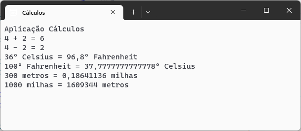

# Calculos :1234:
Aplicação C# para efetuar cálculos

Desenvolvida no âmbito da ação de formação **Introdução ao Git e GitHub**

## Operações suportadas

Neste momento esta aplicação implementa as seguintes operações:

- soma
- subtração
- conversão de temperaturas
    - celsius :arrow_right: fahrenheit
    - fahrenheir :arrow_rigth: celsius
- conversão de distancias
    - metros :arrow_right: milhas
    - milhas :arrow_right: metros

## Tecnologias utilizadas no Projeto

- Visual Studio
- C#
- Git
- GitHub Desktop
- Plataforma GitHub

